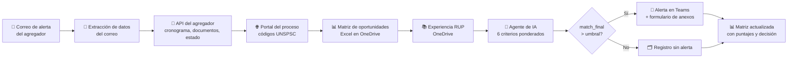
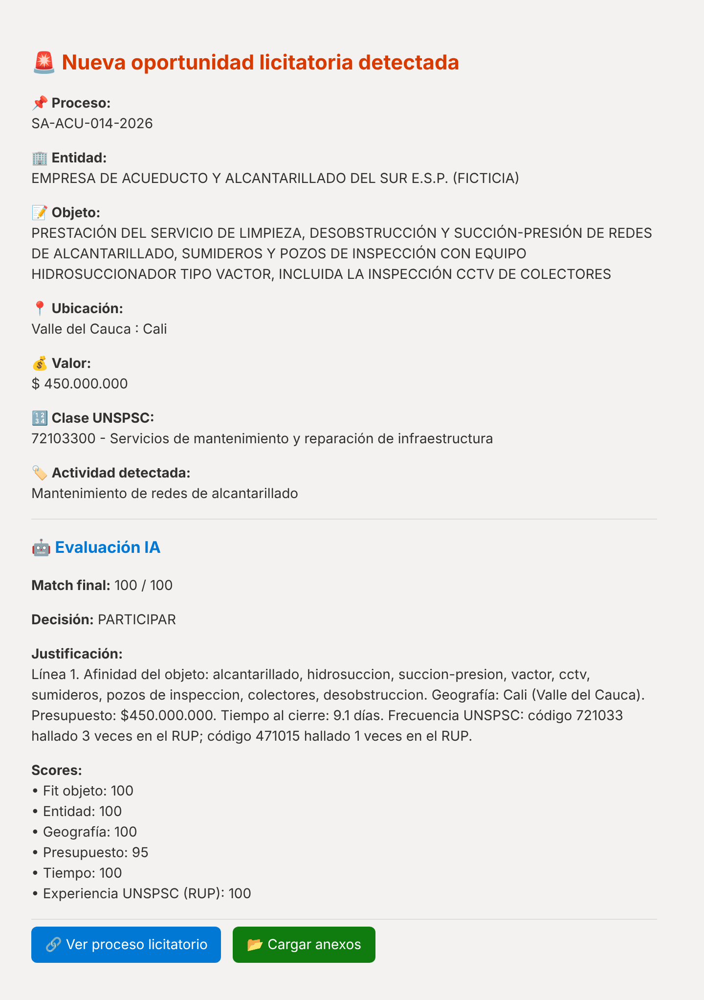
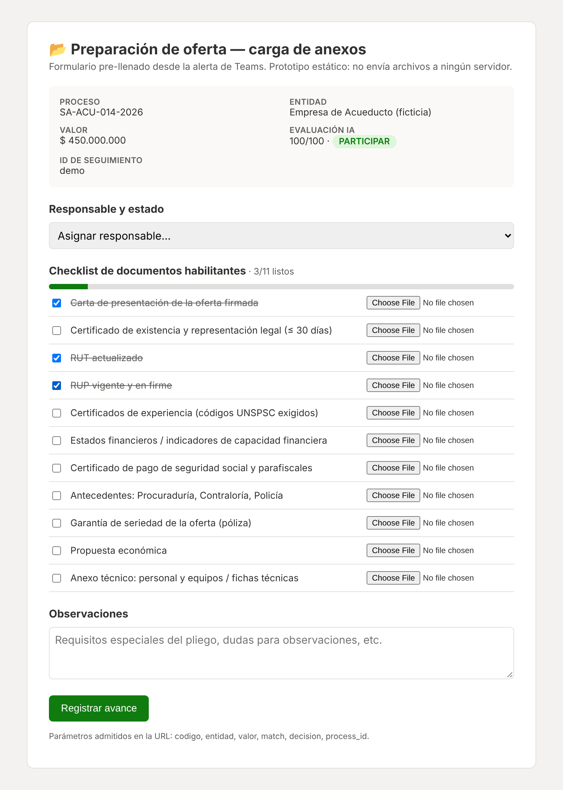

# Flujo de licitaciones · Detección temprana y evaluación de oportunidades de contratación pública con IA

> Automatización en producción para una empresa colombiana del sector de **agua y saneamiento** (limpieza y mantenimiento de redes de acueducto y alcantarillado, y suministro de equipos y repuestos relacionados) que participa en **contratación pública**.
> Este repositorio documenta la solución y trae un **prototipo ejecutable** que reproduce el flujo. Todos los datos son ficticios, y no incluye credenciales ni información de la empresa.

   

---

## El problema

Todos los días se publican en SECOP I, SECOP II y portales privados cientos de procesos de contratación. La empresa recibía las alertas de un agregador de licitaciones **por correo**, y alguien tenía que:

1. abrir cada correo, entrar al portal y leer el objeto, el valor, la ubicación y el cronograma;
2. revisar los códigos **UNSPSC** y compararlos a mano con la experiencia acreditada en el **RUP**;
3. decidir si valía la pena presentarse, y avisar al equipo;
4. empezar a reunir los documentos habilitantes, muchas veces con pocos días antes del cierre.

El proceso era lento y dependía de una sola persona. Además, no dejaba registro de lo que se descartaba ni de por qué.

## La solución

Un flujo automatizado que **lee cada alerta, la enriquece, la evalúa con IA y avisa solo cuando vale la pena**, con un formulario para arrancar de inmediato la preparación de la oferta.



| | Antes | Con el flujo |
|---|---|---|
| Lectura de alertas | Manual, correo por correo | Automática, en minutos desde que llega el correo |
| Análisis de afinidad | Criterio individual | 6 criterios con pesos fijos y justificación escrita |
| Cruce UNSPSC vs. RUP | Manual o no se hacía | Automático, con conteo de ocurrencias |
| Aviso al equipo | Reenvío de correos | Tarjeta en el canal de Teams con botones de acción |
| Trazabilidad | Ninguna | Matriz con **todos** los procesos, incluidos los descartados |
| Preparación documental | Arranca tarde | Formulario pre-llenado y checklist de habilitantes el mismo día |

## Cómo se ve

| Alerta en Microsoft Teams | Formulario de preparación de oferta |
|---|---|
|  |  |

*(Capturas generadas por el prototipo con datos ficticios.)*

## Prueba el prototipo en 1 minuto

No requiere credenciales ni internet. Solo usa la biblioteca estándar de Python (`openpyxl` es opcional para generar el `.xlsx`; sin esa librería, el prototipo escribe un CSV).

```bash
git clone https://github.com/cristhianfruiz94/flujo_licitaciones.git
cd flujo_licitaciones
pip install -r requirements.txt          # opcional (openpyxl)
python -m prototipo.pipeline --limpiar   # corre el flujo con 4 correos de ejemplo
python -m unittest discover -s tests -v  # 14 pruebas
```

Salida esperada:

```text
📥 4 correo(s) de alerta · 📚 8 contratos en RUP · umbral de alerta > 80

🚨 SA-ACU-014-2026        match 100/100  PARTICIPAR       EMPRESA DE ACUEDUCTO Y ALCANTARILLADO DEL SUR E.
🚨 MC-017-2026            match  86/100  PARTICIPAR       ALCALDÍA MUNICIPAL DE SAN ROQUE (FICTICIA)
🗂️  LP-GOB-009-2026        match  29/100  NO PARTICIPAR    GOBERNACIÓN DEPARTAMENTAL (FICTICIA)
🗂️  SI-PTO-022-2026        match  78/100  REVISIÓN MANUAL  SOCIEDAD PORTUARIA DEL CARIBE S.A. (FICTICIA)
```

En `salida/` quedan la matriz `Oportunidades_Licitacion.xlsx`, las tarjetas de Teams en HTML y `resumen_ejecucion.json`. El formulario de anexos se abre directamente en el navegador: `prototipo/web/formulario_anexos.html`.

Para conectar fuentes reales, copia `.env.example` a `.env` y usa `--imap`, `--api`, `--portal` o `--llm` (ver [integraciones](docs/04_integraciones.md)).

## Documentación

| Documento | Contenido |
|---|---|
| [01 · Contexto y problema](docs/01_contexto_y_problema.md) | Negocio, proceso manual previo y objetivos |
| [02 · Arquitectura](docs/02_arquitectura.md) | Componentes, secuencia y decisiones de diseño |
| [03 · Proceso paso a paso](docs/03_proceso_paso_a_paso.md) | Las 7 etapas del flujo y su equivalente en el prototipo |
| [04 · Integraciones](docs/04_integraciones.md) | Correo IMAP, API del agregador, portal, Microsoft 365, OpenRouter |
| [05 · Modelo de evaluación](docs/05_modelo_de_evaluacion.md) | Criterios, tablas de puntaje, pesos y reglas de decisión |
| [06 · Impacto](docs/06_impacto.md) | Beneficios, KPIs y cómo medirlos |
| [07 · Seguridad y privacidad](docs/07_seguridad_y_privacidad.md) | Manejo de credenciales y datos |
| [08 · Lecciones y hoja de ruta](docs/08_lecciones_y_hoja_de_ruta.md) | Hallazgos técnicos y próximos pasos |
| [Diccionario de datos](docs/diccionario_de_datos.md) | Columnas de la matriz de oportunidades |

## Estructura del repositorio

```text
flujo_licitaciones/
├── prototipo/                 # réplica en Python del flujo de producción
│   ├── etapa_01_correo.py     # lectura IMAP / .eml y extracción de datos
│   ├── etapa_02_api.py        # autenticación y consulta a la API del agregador
│   ├── etapa_03_unspsc.py     # scraping del portal y códigos UNSPSC
│   ├── etapa_04_registro.py   # consolidación y matriz Excel (append / upsert)
│   ├── etapa_05_experiencia.py# carga del histórico RUP
│   ├── etapa_06_evaluacion.py # motor de reglas + agente LLM opcional con guardrail
│   ├── etapa_07_alertas.py    # tarjeta Teams, URL de formulario y checklist
│   ├── pipeline.py            # orquestador (CLI)
│   ├── config.py              # perfil de negocio, pesos y variables de entorno
│   └── web/formulario_anexos.html
├── datos_ejemplo/             # correos, respuestas de API, páginas y RUP ficticios
├── docs/                      # documentación funcional y técnica
└── tests/                     # pruebas unitarias y de extremo a extremo
```

## Stack

**Producción:** n8n (orquestación), IMAP, API REST del agregador de licitaciones, scraping HTTP, Microsoft Excel y OneDrive (Graph API), Microsoft Teams, OpenRouter (GPT-4.1) mediante el nodo AI Agent de n8n, y JavaScript en los nodos de código.
**Prototipo:** Python 3.10+ (solo biblioteca estándar) y `openpyxl` como dependencia opcional.

## Nota

El flujo original de n8n no se publica. El prototipo replica su lógica etapa por etapa con nombres equivalentes. El perfil de negocio está parametrizado en [`prototipo/config.py`](prototipo/config.py), así que el mismo motor sirve para otra empresa o sector cambiando palabras clave, geografías y pesos.

Licencia: [MIT](LICENSE).
