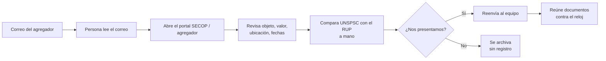

# 01 · Contexto y problema

## El negocio

La empresa usuaria (anonimizada en este repositorio) es una compañía colombiana con dos líneas de negocio que compiten en contratación pública:

| Línea | Qué ofrece | Ejemplos de objetos contractuales de interés |
|---|---|---|
| **Línea 1 · Servicios especializados** | Limpieza, mantenimiento, diagnóstico, rehabilitación y operación de redes de acueducto, alcantarillado y aguas residuales; detección de fugas; inspección de redes; hidrosucción con equipos de succión-presión | "Limpieza y succión-presión de redes de alcantarillado con equipo hidrosuccionador", "Inspección CCTV de colectores" |
| **Línea 2 · Importación y comercialización** | Bienes y repuestos ligados a la Línea 1: boquillas, mangueras de presión-succión, varillas flexométricas y rotosonda, tapones | "Suministro de accesorios y herramientas consumibles para la flota de equipos de succión-presión", "Adquisición de varillas para limpieza de alcantarillado" |

Sus clientes son principalmente **empresas de servicios públicos de agua**, **alcaldías y gobernaciones** y, en menor medida, **puertos e industria**.

## Cómo funcionaba antes

### Puntos de dolor

1. **Volumen y ruido.** El agregador filtra por perfil, pero gran parte de lo que llega no es pertinente (mantenimiento automotor, obra civil, papelería…), y aun así hay que leerlo.
2. **Tiempo.** Muchos procesos de mínima cuantía cierran en 2 a 5 días hábiles. Si el proceso se detecta un día tarde, se pierde buena parte del tiempo para preparar la oferta.
3. **Experiencia acreditable.** Para habilitarse hay que demostrar experiencia en los códigos UNSPSC que pide la entidad, y hacer ese cruce contra el RUP a mano es lento y propenso a errores.
4. **Criterio no estandarizado.** La decisión de participar dependía de quién revisara el correo.
5. **Cero trazabilidad.** No quedaba registro de las oportunidades descartadas, así que no había datos para analizar el mercado ni para mejorar el filtro.

## Objetivos del proyecto

| # | Objetivo | Cómo lo atiende la solución |
|---|---|---|
| O1 | Detectar oportunidades **el mismo día** de su publicación | Disparador por correo nuevo y procesamiento automático |
| O2 | Priorizar con un **criterio único y explicable** | Modelo de 6 criterios con pesos fijos y justificación escrita |
| O3 | Verificar la **experiencia acreditable** | Cruce automático de UNSPSC del proceso con el RUP |
| O4 | Avisar solo lo relevante, **donde el equipo trabaja** | Alerta en un canal de Teams por encima de un umbral |
| O5 | Arrancar la **preparación documental** de inmediato | Botón "Cargar anexos" con formulario pre-llenado y checklist |
| O6 | Crear una **base histórica** de oportunidades | Matriz Excel con todos los procesos y su evaluación |

## Alcance

**Incluye:** la ingesta de alertas, el enriquecimiento, la evaluación, la notificación, el registro y el inicio de la preparación documental.
**No incluye:** la presentación de la oferta en SECOP, la elaboración de la propuesta económica ni la decisión final, que sigue siendo humana. El flujo **recomienda**, el equipo **decide**.
