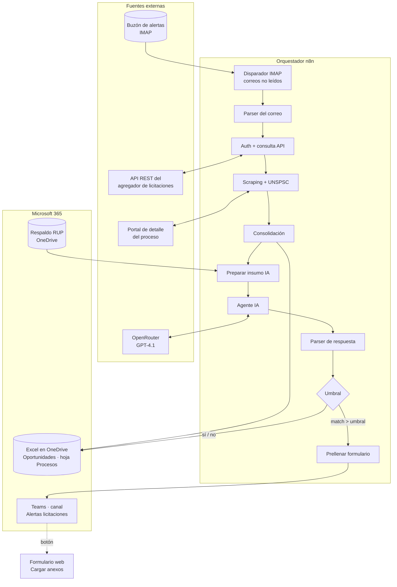
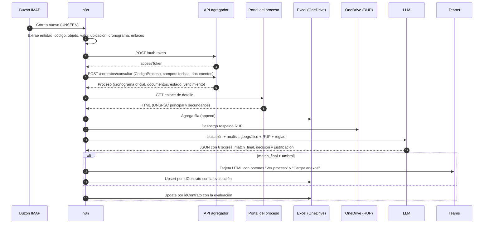

# 02 · Arquitectura

## Vista de componentes

## Secuencia de una alerta

## Decisiones de diseño

| Decisión | Alternativas consideradas | Por qué |
|---|---|---|
| **El correo como disparador**, no polling a la API | Consultar la API cada X minutos | El agregador ya filtra por el perfil de la empresa y el correo llega en tiempo real. Así se evitan consultas innecesarias. |
| **Enriquecer con la API y además con scraping** | Solo uno de los dos | La API trae cronograma y documentos estructurados, y el portal trae la clasificación UNSPSC completa. Cada fuente cubre los vacíos de la otra (hay *fallbacks* campo por campo). |
| **Excel en OneDrive como base de datos** | Base de datos SQL o CRM | El equipo ya trabaja en Microsoft 365. La matriz es visible, filtrable y editable sin herramientas nuevas, y el upsert por `idContrato` evita duplicados. |
| **LLM para evaluar** | Solo reglas | El objeto contractual es texto libre con mucha variación ("hidrosucción", "succión-presión", "Vactor"…). El LLM entiende la afinidad semántica y redacta una justificación legible. |
| **Reglas explícitas en el prompt** | Dejar que el modelo pondere libremente | Los pesos y las tablas de puntaje son decisiones de negocio y deben ser estables y auditables. |
| **Umbral y alerta en Teams** | Correo, WhatsApp | Teams es el canal de trabajo del equipo. La tarjeta permite actuar sin cambiar de herramienta. |
| **Registrar también lo descartado** | Registrar solo las alertas | Sirve para auditar falsos negativos, calibrar el umbral y hacer análisis de mercado. |

## Del flujo n8n al prototipo

El prototipo mantiene la misma separación por etapas. Cada etapa es un módulo con funciones puras y probables, y el orquestador `pipeline.py` las encadena igual que las conexiones del flujo.

| Etapa | Nodos de producción (n8n) | Módulo del prototipo |
|---|---|---|
| 1 | Email Trigger (IMAP) → Obtener datos correo | `etapa_01_correo.py` |
| 2 | Request token → Usar token → API consultar licitación | `etapa_02_api.py` |
| 3 | Scraping website → Identifica UNSPSC | `etapa_03_unspsc.py` |
| 4 | Código preparar Excel → Actualizar Excel | `etapa_04_registro.py` |
| 5 | Download file (OneDrive) → Extract from file | `etapa_05_experiencia.py` |
| 6 | Preparar agente IA → AI Agent (OpenRouter) → Parsear respuesta IA | `etapa_06_evaluacion.py` |
| 7 | If → Prellenar form → Create message (Teams) → Append/Update sheet | `etapa_07_alertas.py` |

La principal diferencia es que **el prototipo calcula los puntajes con un motor de reglas determinístico** que replica el prompt. Con `--llm`, también llama al modelo y usa el motor como *guardrail* (ver [05 · Modelo de evaluación](05_modelo_de_evaluacion.md)).
