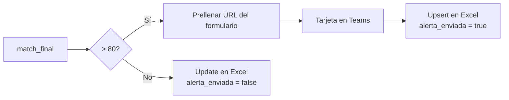

# 03 · Proceso paso a paso

Para ilustrar, se sigue el caso ficticio **SA-ACU-014-2026** (`datos_ejemplo/correos/01_SA-ACU-014-2026.eml`).

---

## Etapa 1 · Recepción y lectura del correo

**Disparador.** El flujo escucha el buzón donde llegan las alertas del agregador y toma solo los correos **no leídos** (`UNSEEN`), guardando el último ID procesado para no repetir correos.

**Extracción.** Un parser lee el asunto y el cuerpo y obtiene:

| Campo | Cómo se obtiene |
|---|---|
| `entidad` | Línea anterior a la modalidad ("Selección…", "Licitación…", "Mínima cuantía"…). Si no aparece, se toma del asunto o de la localización. |
| `numeroProceso` | Cascada de expresiones regulares, de la más específica (`PSMC-031-LM-CAU-2026`) a la más general (`LP001-2026`). |
| `objeto`, `valor` | Texto entre `Objeto:` y `Valor:`, y el monto de `Valor: $…`. |
| `localizacion` → `departamento`, `municipio` | `Localizacion: Valle del Cauca : Cali` |
| `cronograma` | Todas las líneas `Evento: dd/Mmm/aa hh:mm am/pm` (apertura, publicación, cierre…). |
| `documentosClasificados` | Enlaces a documentos clasificados en Estudios previos, CDP, Invitación, Cronograma, Anexos o Matriz de riesgos. |
| `enlaceProceso` | Enlace de detalle del proceso en el agregador. |

## Etapa 2 · Enriquecimiento con la API

1. `POST /auth-token`, que devuelve un token Bearer.
2. `POST /contratos/consultar` con el perfil de búsqueda de la empresa, el filtro `{"CodigoProceso": "<código>"}` y los campos adicionales `fechas` y `documentos`.

Esta consulta agrega datos **oficiales**: el cronograma completo, la lista de documentos con su URL, el estado del proceso, la fecha de vencimiento, los proponentes y los ganadores (cuando el proceso ya fue adjudicado).

## Etapa 3 · Portal del proceso y códigos UNSPSC

Se descarga la página de detalle y se extraen:
- la **clasificación principal** (Segmento, Grupo, Clase y actividad), que viene como JSON embebido en el HTML;
- **todos los códigos UNSPSC secundarios** (patrón `8 dígitos - descripción`), sin duplicados;
- el **número oficial** del proceso, que sirve de respaldo si el correo no lo trajo.

## Etapa 4 · Consolidación y registro

Se fusionan las tres fuentes con esta prioridad: **API > portal > correo**, campo por campo. Por ejemplo, si la API no trae `Valor`, se usa el del correo. El resultado se aplana para Excel:
- `unspsc_1 … unspsc_5` y sus descripciones, más `todos_unspsc`;
- una columna por evento del cronograma (`fecha_y_hora_de_cierre_del_proceso_fecha`, `…_hora`);
- una columna por documento (`doc_estudios_previos`…);
- contadores y banderas (`totalDocumentos`, `tieneAdjuntos`).

La fila se **agrega** a la hoja *Procesos* del libro *Oportunidades_Licitación*.

## Etapa 5 · Experiencia acreditada (RUP)

Se descarga desde OneDrive el respaldo del **Registro Único de Proponentes** (contratos ejecutados con su UNSPSC, valor en SMMLV y contratante) y se convierte a una lista estructurada. Si el archivo viene vacío o con más de 5 % de caracteres ilegibles, se marca `backup_corrupto = true` y la evaluación lo tiene en cuenta.

## Etapa 6 · Evaluación con IA

Se arma el insumo del agente:
- `licitacion` normalizada, con un **análisis geográfico** que clasifica la ubicación en *Mayor interés* (Cali o Bogotá), *Capital de departamento* o *Municipio ordinario*;
- `backup_rup`, que es la lista de contratos.

El agente funciona como un **motor de evaluación**, no como un chatbot: devuelve **solo JSON** con seis puntajes, el `match_final`, la decisión y una justificación que incluye estadísticas del cruce UNSPSC-RUP. Un parser robusto acepta respuestas con *fences* de markdown o con texto alrededor del JSON. Si no logra interpretar la respuesta, la marca como `ERROR` con `match_final = 0`, de modo que el proceso no se alerta por accidente.

Detalle completo en [05 · Modelo de evaluación](05_modelo_de_evaluacion.md).

## Etapa 7 · Decisión, alerta y preparación documental

**La tarjeta de Teams** incluye el proceso, la entidad, el objeto, la ubicación, el valor formateado, la clase UNSPSC, la actividad, el match, la decisión, la justificación, el desglose de puntajes y dos botones:
- **🔗 Ver proceso licitatorio**, que abre el detalle en el portal;
- **📂 Cargar anexos**, que abre un formulario ya diligenciado con código, entidad, valor, match, decisión e ID de seguimiento.

**El formulario de anexos** es donde arranca la preparación de la oferta. Se asigna un responsable, se recorre el checklist de documentos habilitantes y se cargan los soportes. El prototipo genera el checklist según el caso:
- base: carta de presentación, certificado de existencia, RUT, RUP, experiencia, indicadores financieros, seguridad social, antecedentes, póliza de seriedad y propuesta económica;
- **Línea 1**: hojas de vida del personal y relación de equipos;
- **Línea 2**: fichas técnicas y certificados de origen o importación;
- en **mínima cuantía** se retira la póliza de seriedad, que normalmente no se exige.

---

## Resultado del ejemplo

| Proceso | Caso | Match | Decisión | ¿Alerta? |
|---|---|---|---|---|
| SA-ACU-014-2026 | Empresa de acueducto, Cali, limpieza con hidrosuccionador, $450M | 100 | PARTICIPAR | 🚨 Sí |
| MC-017-2026 | Alcaldía en Cundinamarca, suministro de varillas y mangueras, $15M, cierra en 3 días | 86 | PARTICIPAR | 🚨 Sí |
| SI-PTO-022-2026 | Puerto en Barranquilla, hidrosucción pluvial, sin valor, cierra en 1,7 días | 78 | REVISIÓN MANUAL | No (queda en la matriz) |
| LP-GOB-009-2026 | Gobernación, mantenimiento de parque automotor | 29 | NO PARTICIPAR | No |
