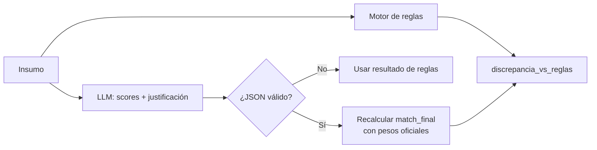

# 05 · Modelo de evaluación

El modelo responde a una pregunta: **¿debe la empresa invertir esfuerzo en presentarse a este proceso?**
Para eso combina seis criterios, cada uno con un puntaje entero de 0 a 100, en un `match_final` ponderado.

## 0. Línea de negocio

Primero se determina a qué línea corresponde el objeto, porque la tabla de geografía y algunas reglas de presupuesto dependen de eso:
- **Línea 2** cuando el objeto es de *suministro / adquisición / compra* **y** menciona bienes de la línea (boquillas, mangueras, varillas, tapones, accesorios…);
- **Línea 1** en cualquier otro caso.

## 1. Fit del objeto (`fit_objeto`) · el criterio maestro

`fit_objeto = 80 % afinidad con las líneas de negocio + 20 % filtros negativos`

- **Afinidad:** palabras y conceptos de la Línea 1 (alcantarillado, hidrosucción, succión-presión, Vactor, sumideros, CCTV, detección de fugas…) y de la Línea 2.
- **Filtros negativos, que se castigan fuertemente:** repuestos automotrices, mantenimiento vehicular, construcción civil pesada, pavimentación, muestreo químico, papelería, mantenimiento de PTAR e instalación de tuberías de drenaje.

> En producción, la afinidad la juzga el LLM, que entiende sinónimos y contexto. El prototipo usa un diccionario de palabras clave (`config.PERFIL`) como aproximación explicable.

## 2. Geografía (`score_geografia`)

| Ubicación | Línea 1 · Servicios | Línea 2 · Comercialización |
|---|---|---|
| Cali (Valle del Cauca) | **100** | **100** |
| Bogotá | 90 | **100** |
| Otros municipios del Valle del Cauca | 90 | 95 |
| Otros municipios de Cundinamarca | 80 | 85 |
| Armenia, Pereira, Manizales, Barranquilla | 80 | 85 |
| Resto del país | 30 | 85 |

La Línea 1 depende de mover equipos pesados y cuadrillas, así que la cercanía a la base de operación pesa mucho. La Línea 2 son despachos de bienes, y la distancia pesa poco.

## 3. Presupuesto (`score_presupuesto`)

| Valor del proceso | Score |
|---|---|
| < $20 M | 20 |
| $20 M – $80 M | 80 |
| $80 M – $500 M | 95 |
| > $500 M | 100 |

Ajustes:
- **$10 M – $20 M en el Valle del Cauca:** 85, porque son procesos pequeños pero cercanos y rentables.
- **< $20 M fuera del Valle en la Línea 1:** se restan 30 puntos, porque movilizar equipos no se justifica.
- **Valor nulo o 0:** el criterio **se elimina** y sus pesos se redistribuyen (escenario B).

## 4. Entidad (`score_entidad`)

| Tier | Tipo de entidad | Score |
|---|---|---|
| 1 | Empresas de servicios públicos de acueducto y alcantarillado | 100 |
| 2 | Alcaldías y gobernaciones con objeto de agua o saneamiento | 85 |
| 3 | Puertos y petroleras | 60 |

## 5. Tiempo (`score_tiempo`)

Días entre la recepción de la alerta y el cierre del proceso:

| Días disponibles | Score |
|---|---|
| > 4 | 100 |
| 2 – 4 | 60 |
| < 2 | 20 |

## 6. Experiencia UNSPSC en el RUP (`score_frecuencia_unspsc`)

Se comparan los **6 primeros dígitos** (hasta el nivel de clase) de cada código del proceso con el histórico del RUP:

| Resultado | Score |
|---|---|
| El principal y **todos** los secundarios aparecen al menos una vez | 100 |
| El principal **o alguno** de los secundarios aparece | 85 |
| **Ninguno** aparece | 20 |

La justificación debe traer los conteos, por ejemplo: *"código 721033 hallado 3 veces en el RUP; código 471015 hallado 1 vez"*. Esto le dice al equipo qué contratos usar como experiencia.

## Ponderación

| Criterio | Escenario A · con presupuesto | Escenario B · sin presupuesto |
|---|---|---|
| Fit del objeto | **35 %** | **38 %** |
| Geografía | 25 % | 27 % |
| Experiencia UNSPSC (RUP) | 15 % | 15 % |
| Entidad | 15 % | 5 % |
| Tiempo | 5 % | 15 % |
| Presupuesto | 5 % | — |
| **Total** | 100 % | 100 % |

`match_final = Σ (score × peso)`, redondeado a entero de 0 a 100.

## Decisión

| `match_final` | Decisión |
|---|---|
| ≥ 85 | **PARTICIPAR** |
| 60 – 84 | **REVISIÓN MANUAL** |
| < 60 | **NO PARTICIPAR** |

**Umbral de alerta en Teams:** `match_final > 80` (configurable con `UMBRAL_ALERTA` o `--umbral`). Por eso los procesos entre 81 y 84 llegan a Teams marcados como *Revisión manual*: el equipo los ve, pero sabe que requieren análisis.

## Ejemplo de cálculo · SA-ACU-014-2026 (escenario A)

| Criterio | Score | Peso | Aporte |
|---|---|---|---|
| Fit del objeto | 100 | 0,35 | 35,00 |
| Geografía (Cali, Línea 1) | 100 | 0,25 | 25,00 |
| Experiencia UNSPSC | 100 | 0,15 | 15,00 |
| Entidad (Tier 1) | 100 | 0,15 | 15,00 |
| Tiempo (9,1 días) | 100 | 0,05 | 5,00 |
| Presupuesto ($450 M) | 95 | 0,05 | 4,75 |
| **match_final** | | | **99,75 → 100** |

## Contrato de salida del agente

```json
{
  "idContrato": "SA-ACU-014-2026",
  "codigoProceso": "SA-ACU-014-2026",
  "fit_objeto": 100,
  "score_entidad": 100,
  "score_geografia": 100,
  "score_presupuesto": 95,
  "presupuesto_eliminado_de_ponderacion": false,
  "score_tiempo": 100,
  "score_frecuencia_unspsc": 100,
  "descarte_temprano": false,
  "evidencia_insuficiente": false,
  "backup_corrupto": false,
  "match_final": 100,
  "decision": "PARTICIPAR",
  "justificacion": "Línea 1. Afinidad del objeto: alcantarillado, hidrosucción, … código 721033 hallado 3 veces en el RUP …"
}
```

## LLM + guardrail (modo `--llm` del prototipo)



El LLM aporta **criterio semántico** (afinidad del objeto, tipo de entidad) y **redacción**. La aritmética y la regla de decisión se recalculan en código, así el resultado no depende de que el modelo multiplique bien. La columna `discrepancia_vs_reglas` sirve para detectar desvíos y calibrar el prompt.
